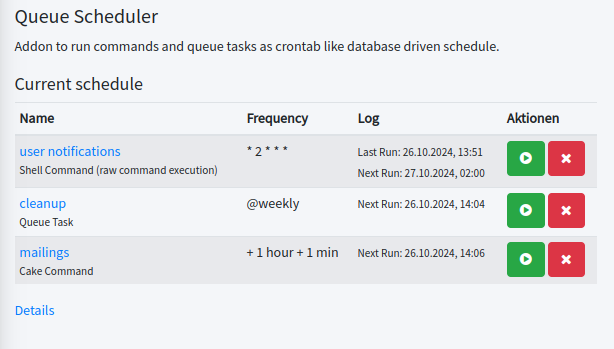

# CakePHP QueueScheduler plugin

The `cake6` development branch requires PHP 8.5 and CakePHP 6.

A scheduler addon for [Queue plugin](https://github.com/dereuromark/cakephp-queue).

Manage recurring Queue jobs in a database-backed admin. The dispatcher queues due tasks; Queue workers execute them separately.

Schedules support cron expressions, relative intervals, time windows, and manual runs. Use one scheduler dispatcher per database; workers can run on several hosts.

[Documentation](https://dereuromark.github.io/cakephp-queue-scheduler/) · [Installation](https://dereuromark.github.io/cakephp-queue-scheduler/guide/installation) · [Getting started](https://dereuromark.github.io/cakephp-queue-scheduler/guide/getting-started)

The published website covers the stable CakePHP 5 release. Use this branch's documentation for CakePHP 6 installation and upgrades.

## Credit where credit is due
This plugin is heavily inspired by [LordSimal Scheduler plugin](https://github.com/LordSimal/cakephp-scheduler)
and [Laravel Task Scheduling Feature](https://laravel.com/docs/10.x/scheduling).

Use this Scheduler plugin if you prefer configuring them file-based and purely in crontab style.
